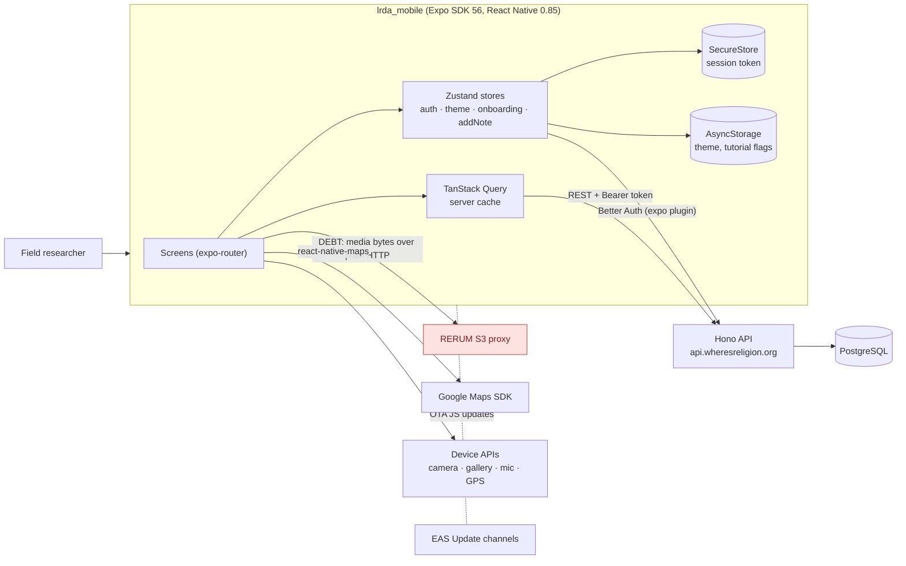
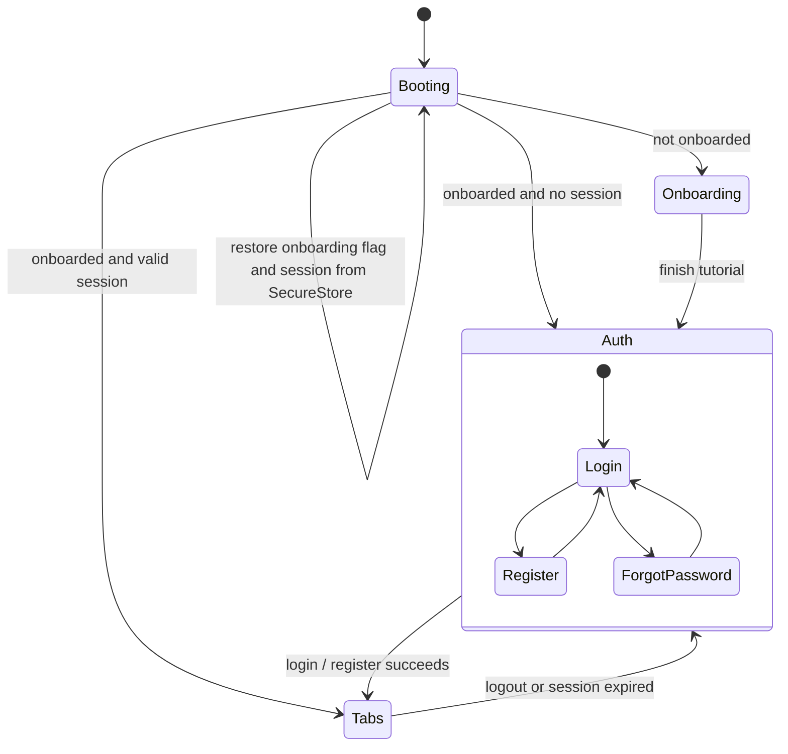
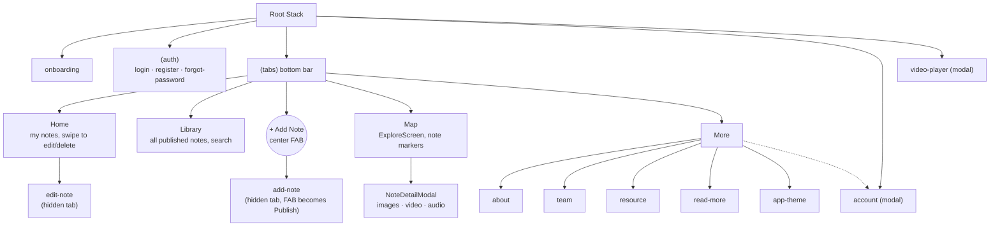
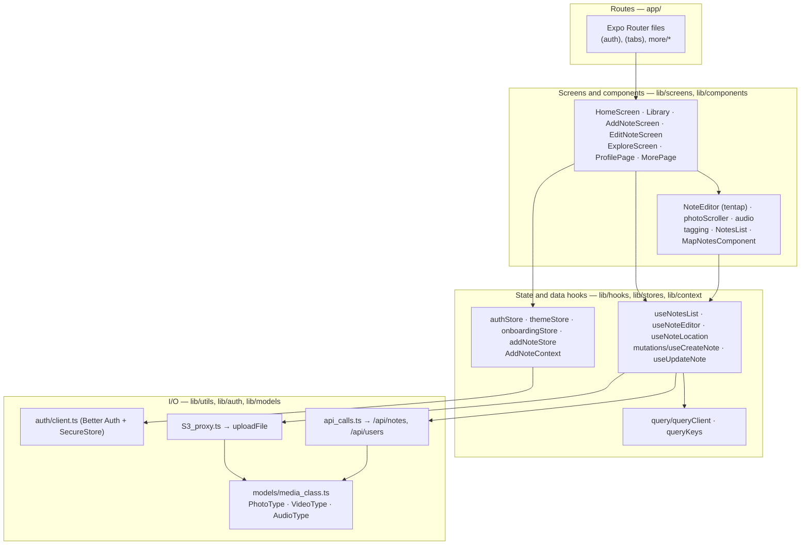
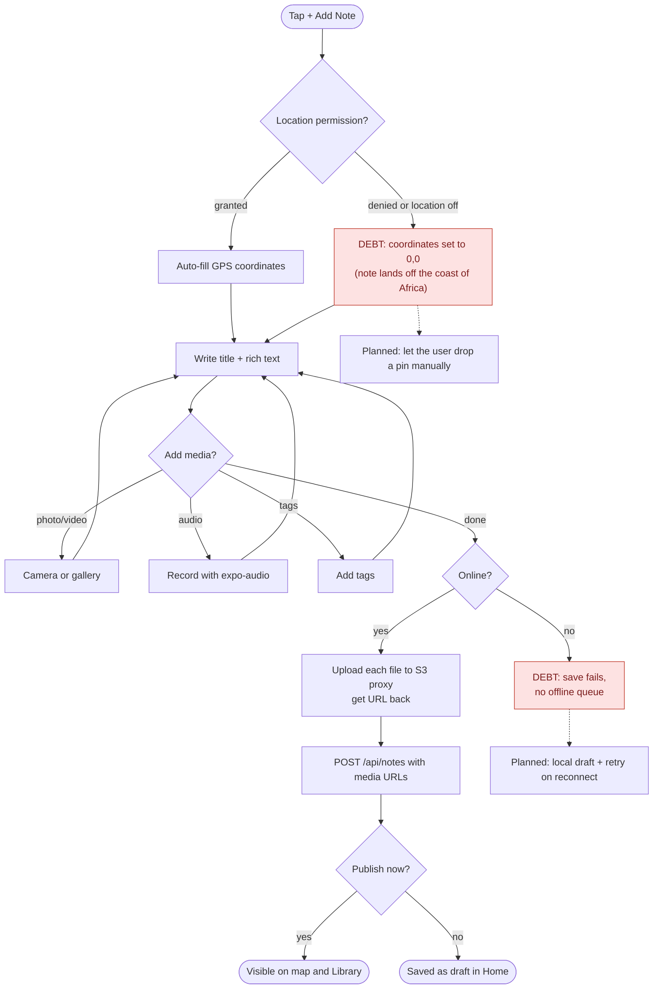
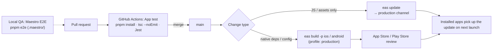

# Where's Religion? Mobile — Design Artifacts

Design artifacts for the Expo / React Native app. The shared backend (API, database, deployment) is documented in [`lrda_website/docs/design/system-design.md`](https://github.com/oss-slu/lrda_website/blob/main/docs/design/system-design.md). That document also has the system context, the ERD and the note lifecycle, all of which apply to mobile too.

All diagrams are [Mermaid](https://mermaid.js.org/) and render on GitHub. To edit one, paste it into [mermaid.live](https://mermaid.live).

**Legend:** solid line = current state · dashed line = planned or future state · **DEBT** = known technical debt (red nodes)

| # | Artifact | Type | Notation |
|---|---|---|---|
| 1 | [Mobile in the system](#1-mobile-in-the-system) | Component | C4-style container diagram |
| 2 | [App startup and navigation gating](#2-app-startup-and-navigation-gating) | State | UML state machine |
| 3 | [Information architecture](#3-information-architecture-screens-and-tabs) | Navigation hierarchy | Flowchart |
| 4 | [Module layers](#4-module-layers) | Software architecture | Layered component diagram |
| 5 | [Field capture flow](#5-user-flow--capturing-a-note-in-the-field) | User flow | Flowchart |
| 6 | [Build and release](#6-build-and-release-pipeline) | Deployment | Flowchart |
| 7 | [Technical debt and future state](#7-technical-debt-and-intended-future-state) | Annotated summary | Table |

---

## 1. Mobile in the system

The mobile app is a **thin client**. It has no database of its own, and every note is read from and written to the shared API. Unlike the web app, auth uses a **Bearer token** kept in SecureStore, not a cookie.

---

## 2. App startup and navigation gating

`app/_layout.tsx` restores the onboarding and auth state, then uses `Stack.Protected` guards to show exactly one route group.

**Decision:** gating is declarative (route guards), not imperative `router.replace()` calls, so it's impossible to deep-link into `(tabs)` without a session.

---

## 3. Information architecture (screens and tabs)

The **More** tab mirrors the website's public pages (about, team, resources), so content changes the client asks for on the website usually need matching changes here.

---

## 4. Module layers

Dependencies point downward only. Screens never call `fetch` directly.

---

## 5. User flow — capturing a note in the field

This is the main mobile workflow and the reason the app exists alongside the website.

---

## 6. Build and release pipeline

**Trade-off:** OTA updates ship fixes without store review, but only for JavaScript changes. Anything that touches native code (Expo SDK upgrades, new permissions, `app.config.js`) needs a full store build.

---

## 7. Technical debt and intended future state

| Debt | Where | Impact | Intended state |
|---|---|---|---|
| Media uploads go to an unauthenticated third-party proxy, over **plain HTTP** in the production profile | `lib/utils/S3_proxy.ts`, `eas.json` | Uploads can be intercepted or spoofed; we don't own the storage | Request a presigned S3 POST from the API, then upload directly over HTTPS (see website §2) |
| Denied location permission saves the note at 0,0 | `lib/hooks/useNoteLocation.ts` | Notes appear in the ocean on the map and pollute the research data | Store a null location and ask the user to pick one on the map |
| No offline support | Add-note flow | Field researchers often have poor signal, and a note is lost if a save fails | Persist drafts locally, queue uploads, retry when back online |
| No thumbnails | Library, map modals | Large originals are slow on cellular and use a lot of memory | Use the `thumbnailUri` produced by the planned Lambda |
| Types copied by hand from the API | `types.ts` | The API contract can change without the app noticing | Consume `@lrda/shared` Zod schemas |
| Website docs describe the old architecture | `lrda_website/packages/docs/mobile/architecture.md` (Redux, React Navigation, Yarn) | Misleads new contributors | Point it at this document |
| CI runs typecheck + unit tests only | `.github/workflows/Native.yml` | E2E (Maestro) is manual | Run Maestro on an emulator in CI before releases |
| Public content (about, team, resources) is duplicated from the website | `lib/screens/AboutScreen.tsx`, `TeamPage.tsx`, `ResourceScreen.tsx` | Every client content change has to be made twice | Serve the content from the API or a shared JSON file |
